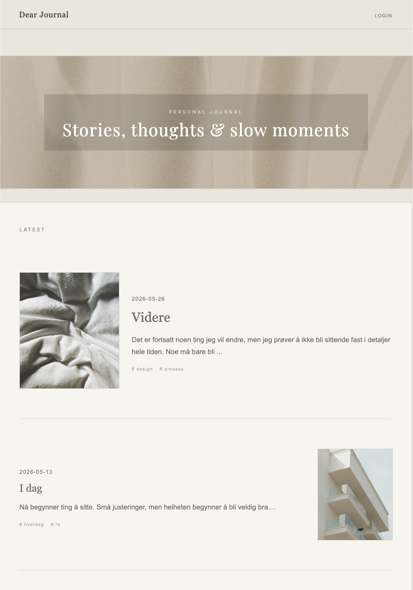
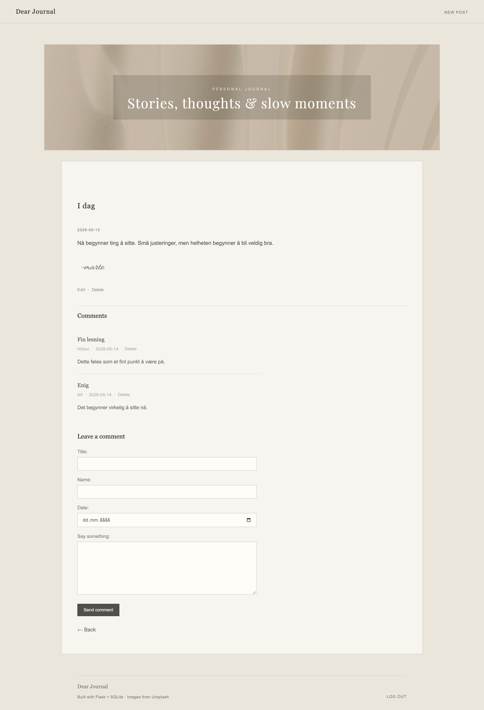
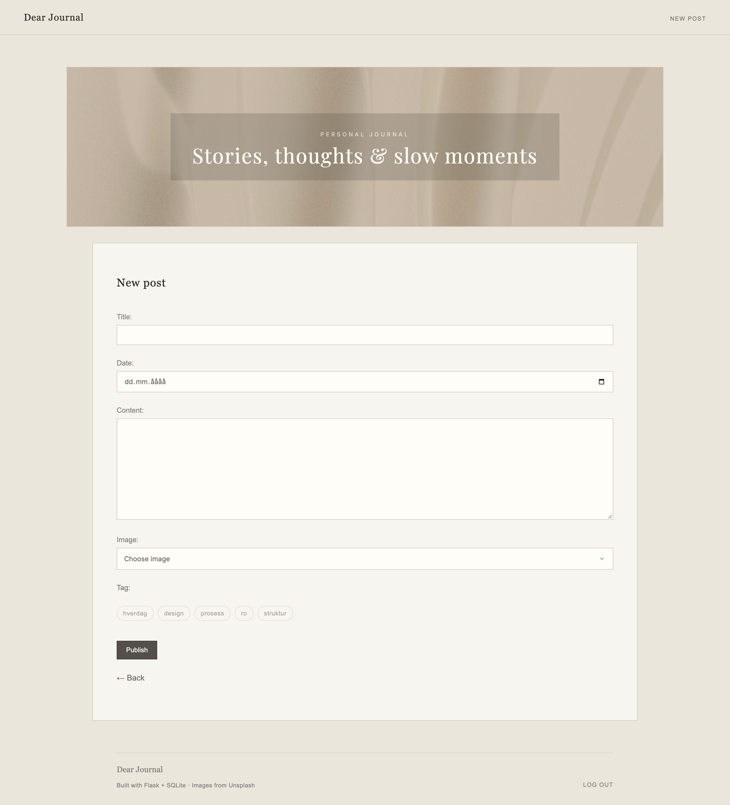

# Dear Journal

Dear Journal is a personal blogging application built with Flask and SQLite.
The application lets users view blog posts, read individual posts, add comments, edit existing posts, and filter posts by tags. 

## Preview 








## Features 

- View all blog posts on the homepage 
- View a single blog post
- Create new blog posts 
- Edit existing blog posts 
- Delete blog posts and comments
- Add comments to blog posts 
- Filter blog posts by tag 
- Display title, date, body, image and tags for each post 
- Admin login system using Flask sessions
- Protected create, edit, and delete functionality
- SQLite database with seed data 
- Jinja2 template inheritance with a shared base layout 


## Technologies used 

- Python 
- Flask 
- SQLite 
- Jinja2 
- HTML
- CSS


## Setup and how to run

Clone the repository:

```
git clone https://github.com/mbekkhus/FinalProject-DearJournal-PRO1002.git
cd FinalProject-DearJournal-PRO1002
```

Create and activate a virtual environment: 

```
python3 -m venv .venv
source .venv/bin/activate
```

Install dependencies: 

`pip install -r requirements.txt`

Create the database: 

`sqlite3 blog.db < schema.sql`

Run the application: 

`.venv/bin/python3 app.py`


Open in browser: 

<http://127.0.0.1:5001>


## Login 

Creating, editing, and deleting posts requires admin login. 

Username: admin 
Password: 123 


## Project structure 

app.py - Flask routes and application logic 
database.py - Database connection and query functions 
schema.sql - Database schema and seed data 
templates/ - Jinja2 HTML templates 
static/ - CSS and images 


## Known limitations 

- The login system uses a simple hardcoded admin account for demonstration purposes
- Tags can be added when creating a post, but existing tags cannot yet be edited from the edit form
- The date field is stored in ISO format to make sorting by date easier


## Future improvements 

- Allow users to add and edit tags from the form 
- Add flash messages after creating or editing posts 
- Add more automated tests 
- Replace the hardcoded admin account with proper user authentication system


## Security considerations 

The application uses parameterized SQL queries with placeholders to reduce the risk of SQL injection. User input is also validated in the Flask routes before being saved to the database, and Jinja2's built-in auto-escaping protects against script injection in rendered HTML.
The Flask secret key is loaded from an environment variable, with a development fallback for local testing. 


## Testing 

The application has been manually tested in the browser to verify core functionality. 

The following user flows have been tested: 

- Creating new blog posts
- Viewing all posts on the homepage 
- Viewing individual blog posts 
- Editing existing blog posts 
- Deleting blog posts
- Adding and deleting comments
- Filtering posts by tags 

Basic validation has been implemented in the Flask routes to ensure that required fields are not empty before saving data.

Automated tests have been implemented using pytest and SQLite. 
The test suite uses a temporary test database created from the schema file and verifies key functionality such as database setup, tag filtering, comment creation, and selected application routes. 


## How to run tests 

Run the following command from the project root: 

`pytest`

The test suite creates a temporary SQLite test database, loads the schema and seed data, and runs a set of automated tests covering database functionality and selected Flask routes. 
The temporary database is removed automatically after the tests have completed. 

